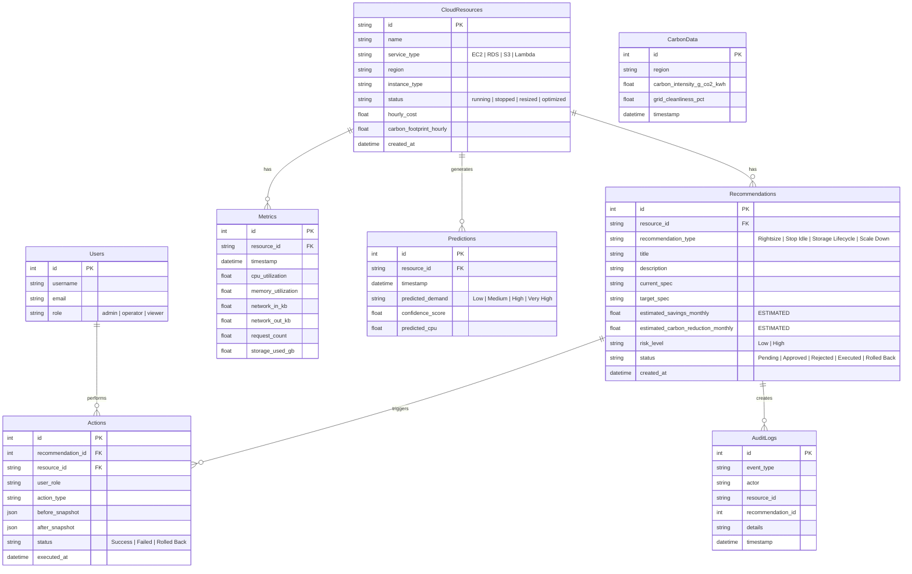

# GreenCloud AI — Implementation Plan

**Project**: GreenCloud AI — AI-Powered Sustainable Cloud Optimization & Carbon-Aware Workload Management Platform  
**Role**: Senior Full-Stack & ML Engineer / Product Designer  
**Status**: Planning Phase (Pending User Approval)

---

## 1. Executive Summary & Architecture Overview

GreenCloud AI is a production-grade prototype platform that monitors simulated AWS cloud infrastructure, predicts workload demand using machine learning, recommends cost and carbon optimizations, enforces automated risk governance, and executes approved actions with automatic rollback verification.

### Key Architecture Components

```
┌───────────────────────────────────────────────────────────────────────────┐
│                           Next.js 14 Frontend                             │
│  (App Router, TypeScript, Tailwind CSS, Lucide Icons, Recharts, Framer)   │
└─────────────────────────────────────┬─────────────────────────────────────┘
                                      │ REST API calls (fetch)
┌─────────────────────────────────────▼─────────────────────────────────────┐
│                           FastAPI Backend (Python)                        │
│  ├── Routers: /resources, /metrics, /recommendations, /carbon, /green-score│
│  ├── Services: Optimizer Engine, Safety Validator, Action Runner          │
│  └── Storage: SQLAlchemy ORM + SQLite database (greencloud.db)            │
└───────────────────┬───────────────────────────────────┬───────────────────┘
                    │                                   │
┌───────────────────▼──────────────────┐   ┌────────────▼───────────────────┐
│     ML Engine & Predictor            │   │  AWS Mock Provider             │
│  ├── Scikit-learn / XGBoost model    │   │  ├── Synthetic Data Generator  │
│  └── Demand Classifier (RF / XGB)    │   │  └── CloudWatch/EC2/RDS/S3 Mock│
└──────────────────────────────────────┘   └────────────────────────────────┘
```

---

## 2. File Structure

```
GreenCloud/
├── backend/
│   ├── app/
│   │   ├── __init__.py
│   │   ├── main.py                     # FastAPI application entrypoint & CORS
│   │   ├── config.py                   # App configurations & settings
│   │   ├── database.py                 # SQLAlchemy DB engine & session
│   │   ├── models/                     # SQLAlchemy ORM models
│   │   │   ├── __init__.py
│   │   │   └── models.py
│   │   ├── schemas/                    # Pydantic models for validation
│   │   │   ├── __init__.py
│   │   │   └── schemas.py
│   │   ├── api/                        # Endpoint routers
│   │   │   ├── __init__.py
│   │   │   ├── resources.py
│   │   │   ├── metrics.py
│   │   │   ├── recommendations.py
│   │   │   ├── predictions.py
│   │   │   ├── carbon.py
│   │   │   ├── green_score.py
│   │   │   ├── cost.py
│   │   │   ├── audit.py
│   │   │   └── scheduler.py
│   │   └── services/                   # Business logic layers
│   │       ├── __init__.py
│   │       ├── mock_provider.py        # AWS Mock Client interface
│   │       ├── optimizer.py            # Optimization & comparison engine
│   │       ├── safety_rules.py         # Risk classification & safety checks
│   │       ├── action_executor.py      # Execution & rollback verification
│   │       └── green_score_calc.py     # Composite score calculator
│   ├── requirements.txt                # Python dependencies
│   └── seed_db.py                      # Data generation & DB population script
├── ml/
│   ├── synthetic_generator.py          # 30-day hourly metrics generator
│   ├── train.py                        # RF/XGBoost model training script
│   ├── evaluate.py                     # MAE/RMSE/R²/F1 evaluation script
│   ├── predictor.py                    # Inference wrapper
│   └── model.joblib                    # Saved trained model artifact
├── frontend/
│   ├── app/
│   │   ├── layout.tsx                  # Root layout with dark mode & providers
│   │   ├── page.tsx                    # Overview Dashboard (Green Score, KPIs, feed)
│   │   ├── resources/
│   │   │   ├── page.tsx                # Resources List page
│   │   │   └── [id]/page.tsx           # Resource Detail view
│   │   ├── recommendations/
│   │   │   └── page.tsx                # Recommendations Queue & Action Hub
│   │   ├── carbon/
│   │   │   └── page.tsx                # Carbon & Sustainability View + Scheduler
│   │   ├── audit/
│   │   │   └── page.tsx                # Audit Log / Governance Timeline
│   │   └── settings/
│   │       └── page.tsx                # Score weights & Risk policy settings
│   ├── components/
│   │   ├── navbar.tsx                  # Top navigation & global status
│   │   ├── sidebar.tsx                 # Navigation sidebar
│   │   ├── kpi-card.tsx                # Animated KPI card component
│   │   ├── green-score-gauge.tsx       # Interactive Green Score visualizer
│   │   ├── efficiency-chart.tsx        # Service-level efficiency chart
│   │   ├── carbon-trend-chart.tsx      # Carbon reduction trend chart
│   │   ├── resource-table.tsx          # Filterable & searchable resource table
│   │   ├── recommendation-card.tsx     # Card with risk badges & action triggers
│   │   ├── scheduler-tool.tsx          # Carbon-Aware Workload Scheduler component
│   │   ├── audit-table.tsx             # Timestamped governance log
│   │   └── ui/                         # Base UI components (buttons, badges, modals, sliders)
│   ├── lib/
│   │   ├── api.ts                      # Axios/fetch API client wrapper
│   │   └── utils.ts                    # Classnames & formatting utilities
│   ├── public/
│   ├── tailwind.config.js
│   ├── package.json
│   └── tsconfig.json
├── infra/                              # Infrastructure as Code stubs (Terraform)
│   ├── main.tf                         # Main AWS architecture configuration
│   ├── variables.tf                    # Infrastructure input variables
│   ├── vpc.tf                          # VPC & Subnet design
│   ├── iam.tf                          # IAM roles & policy definitions
│   └── cloudwatch.tf                   # CloudWatch alarm definitions
├── docs/
│   ├── architecture.md                 # Detailed architecture documentation
│   └── data-model.md                   # Database schema & entity documentation
├── docker-compose.yml                  # One-command orchestration
├── implementation_plan.md
└── task.md
```

---

## 3. Data Model & Schema

Database: SQLite (`greencloud.db`) using SQLAlchemy ORM.



---

## 4. Design System & Aesthetics

### Color Palette (Emerald & Dark Forest Theme)
- **Background (Dark)**: `#0B1311` (Deep Obsidian Forest)
- **Surface / Card (Dark)**: `#13221E` (Dark Emerald Container) with subtle border `#1C352E`
- **Surface Hover**: `#1B2F2A`
- **Primary Accent**: `#10B981` (Vibrant Emerald / Green Score)
- **Primary Gradient**: `linear-gradient(135deg, #059669 0%, #10B981 100%)`
- **Warning / Alert Accent**: `#F59E0B` (Warm Amber for High Risk / Pending Approvals)
- **Critical / Danger**: `#EF4444` (Coral Red for Regressions & Rollbacks)
- **Text Primary**: `#F3F4F6`
- **Text Secondary**: `#9CA3AF`
- **Glassmorphism**: `backdrop-blur-md bg-[#13221E]/80 border border-[#1C352E]`

### Typography & Icons
- Font Family: Inter / Outfit via Google Fonts
- Icons: `lucide-react` (Server, Cpu, HardDrive, Zap, Leaf, ShieldAlert, CheckCircle2, RotateCcw, Activity, Scale, DollarSign, TrendingDown)

### Design Elements
- **Hero Green Score Gauge**: Animated composite dial (0–100 score) with real-time breakdown of Utilization (30%), Cost Efficiency (35%), Carbon Reduction (25%), and Automation Safety (10%).
- **Risk Communication**: Low Risk (Emerald Shield + Badge), High Risk (Warm Amber Alert Triangle + Modal Confirmation).
- **Interactive Carbon-Aware Scheduler**: Map / Region comparison cards showing `us-east-1` (high grid intensity), `eu-west-1` (low carbon wind/hydro), `ap-southeast-1` (hybrid grid), helping users pick optimal execution windows.

---

## 5. End-to-End Pipeline Implementation (11 Steps)

1. **Watch**: Ingestion pipeline generating synthetic metrics for 30+ days (EC2, RDS, S3, Lambda).
2. **Remember**: Save metrics and resource definitions into SQLite database.
3. **Learn**: Train Random Forest / XGBoost model (`ml/train.py`) with metric history, evaluating MAE/RMSE and F1 classification. Save `ml/model.joblib`.
4. **Predict**: Score current 24-hour metrics and project next 24-hour demand levels (Low/Medium/High/Very High).
5. **Compare**: Rule-based + ML engine detecting oversized resources (e.g. `t3.large` running at <15% CPU).
6. **Suggest**: Formulate actionable recommendations with explicitly marked ESTIMATED monthly savings ($) and carbon reduction (kg CO2e).
7. **Safety Check**: Policy validation rule engine (e.g., prod vs non-prod, max scale percentage) categorizing items into Low Risk vs High Risk.
8. **Decide**: Low-risk actions auto-eligible for execution; High-risk require human approval step with simulated IAM role checks.
9. **Act**: Execute mock state change (e.g. `t3.large` -> `t3.small`), log before snapshot.
10. **Verify**: Post-action metric simulation. If CPU > 85% or error state occurs, auto-trigger rollback and log reasons.
11. **Report**: Consolidated executive overview with Green Score, ROI, carbon impact, and detailed audit trail.

---

## 6. Execution Milestones & Task Checklist

- [x] **Milestone 1**: Project Structure & Architecture Docs
- [x] **Milestone 2**: Synthetic Data Generator & ML Training Pipeline
- [x] **Milestone 3**: FastAPI Backend Development (Models, Routers, Optimizer, Safety Rules)
- [x] **Milestone 4**: Next.js Frontend Development (Theme, Components, Dashboard Pages)
- [x] **Milestone 5**: Carbon Scheduler, Audit Log & Settings Features
- [x] **Milestone 6**: Infrastructure Terraform Stubs & Docker Compose Setup
- [x] **Milestone 7**: Visual Polish, Browser Subagent Click-Through Verification & Screenshots
- [x] **Milestone 8**: Produce Walkthrough Artifact (`walkthrough.md`)

---

## 7. Clarifications & Assumptions
- All monetary and carbon values displayed in the UI are strictly estimates derived from standard AWS pricing and EPA/electricityMap emission factors.
- No live cloud credentials are required; mock AWS provider simulates all API interactions.
